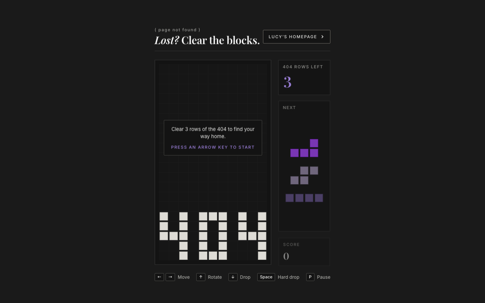

# 404 block game

The block game on the 404 page of bichakhchyan.com. Clear 3 rows of the 404 to find your way back to the homepage.

**[Play it live](https://lucybichakhchyan.github.io/404-tetris/)**

## How to play

The left and right arrows move a block, the up arrow rotates it and the down arrow drops it one row. Space drops it all the way, and P pauses the game.

## How it is built

The page is `index.html`, with styles in `style.css` and the game in `script.js`. The game is drawn on an HTML canvas with plain JavaScript and no libraries.

## License

The code is available under the [MIT License](LICENSE).
